# City & Environment Upgrades & Dynamic Road Mechanics Verification

This document provides visual verification and architectural documentation for the major environment, alternate routing, and dynamic road mechanics upgrades implemented in **Ridgeline Rally** running on **Godot 4.7**.

---

## 1. Upgrades Overview

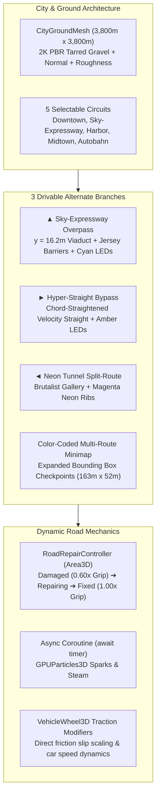

---

## 2. Visual Verification Gallery

### ▲ Sky-Expressway Overpass (y = 16.2m Elevated Viaduct)
Elevated double-decker highway viaduct rising on inclined concrete approach ramps to an altitude of **$y = 16.2\text{m}$**, sweeping across the boulevard canyon with continuous Jersey concrete crash barriers, dual glowing cyan LED guidance strips, and portal frame viaduct piers.

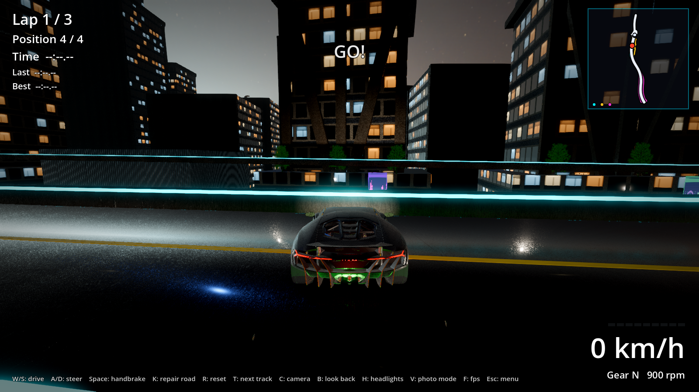

---

### ► Hyper-Straight Bypass (Chord-Straightened Top-Speed Straight)
Outer high-velocity straightaway corridor that straightens the track curvature into a chord, allowing cars to reach top terminal velocities. Protected by amber neon portal gantries and illuminated edge barriers.

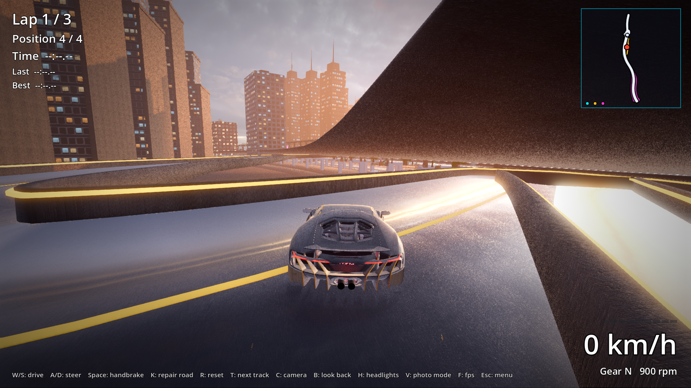

---

### ◄ Neon Tunnel Split-Route (Brutalist Tunnel Gallery)
Covered brutalist concrete gallery featuring structural portal arches and overhead magenta neon light ribs spaced every $8.5\text{m}$, creating a high-speed underground sensory experience.

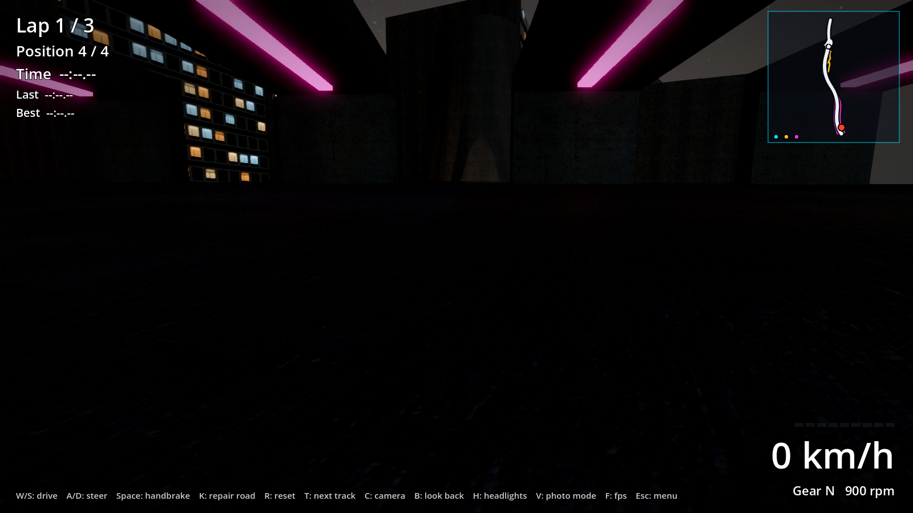

---

### Color-Coded Multi-Route Minimap & Expanded Lap Checkpoints
The HUD top-right minimap renders the main circuit along with color-coded alternate routes:
- **Electric Cyan (`#00F2FF`)**: Sky-Expressway Overpass ($y = 16.2\text{m}$)
- **Amber Gold (`#FFC71E`)**: Hyper-Straight Bypass
- **Cyber Magenta (`#FF2AD1`)**: Neon Tunnel Split-Route
- **Lap Checkpoints**: Expanded bounding box volume ($163\text{m} \times 52\text{m}$) ensures lap detection across ground avenues, elevated overpasses, and outer bypasses.

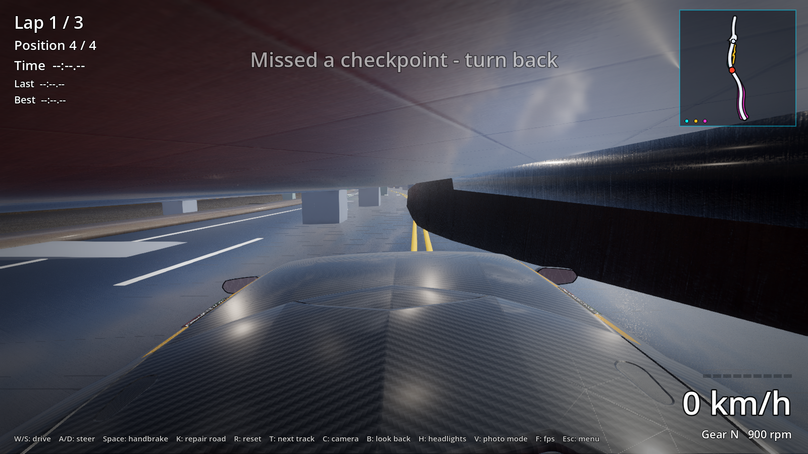

---

### Dynamic Road Mechanics: RoadRepairController
Ported from Unity C# to native **Godot 4.7 GDScript** (`road_repair_controller.gd`). Manages dynamic road conditions:

#### 1. DAMAGED State
The road surface displays broken, cracked potholed asphalt, cautionary orange hazard striping, and amber safety cones. Driving over this section reduces traction to **$0.60\times$** on all `VehicleWheel3D` instances.

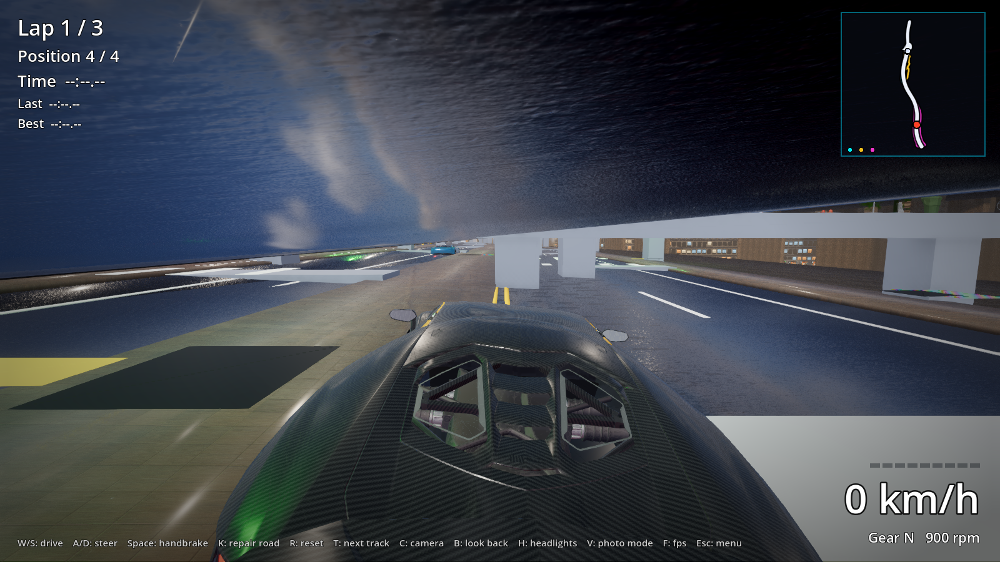

#### 2. REPAIRING Routine (Async Coroutine & Particles)
Triggered via user input (`K` key / `repair_road` action) or programmatic dispatch. Dispatches road repair crews, triggers asphalt steam and welding sparks via `GPUParticles3D`, and executes non-blocking asynchronous timing via `await get_tree().create_timer(repair_duration).timeout`.

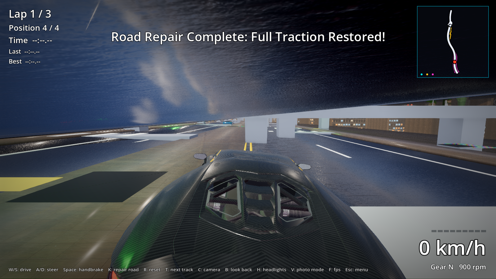

#### 3. FIXED State (Full Traction Restored)
Visuals dynamically toggle to clean, smooth obsidian asphalt with a crisp white center lane divider. Car wheel friction slip is instantly restored to **$1.00\times$** ($1.60$ rear / $1.45$ front).

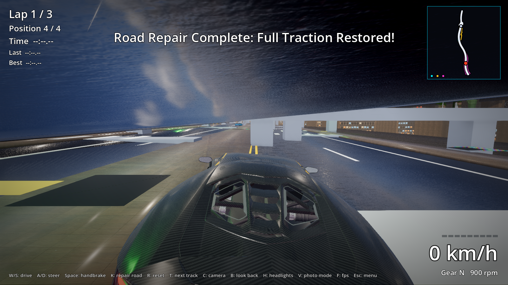

---

### CityGroundMesh (3,800m with 2K PBR Materials)
The foundational ground plaza mesh (`CityGroundMesh`) is scaled to **$3,800\text{m} \times 3,800\text{m}$**, textured with 2048x2048 (2K) photo-scanned tarred gravel diffuse, normal (`tarred_gravel_nor_gl.jpg`), and roughness (`tarred_gravel_rough.jpg`) maps with triplanar world mapping.

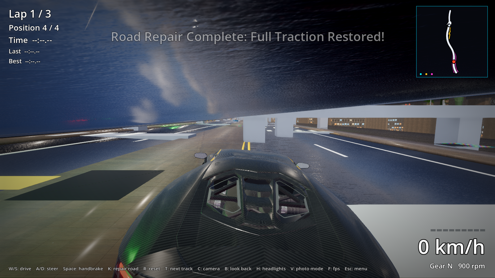

---

### 5 Selectable City Circuits

| Track Index | Circuit Name | Profile / Key Feature | District |
|:---:|:---|:---|:---|
| **0** | **Neo-Veridia // Sector-9** | Flagship metropolis core, multi-level overpass, hyper-straight & harbor | NEO-VERIDIA // SECTOR-9 |
| **1** | **Veridia Sky-Expressway** | Sweeping multi-tiered viaduct highway with high elevation ramps | SKY-EXPRESSWAY // INTERCHANGE |
| **2** | **Cyber-Harbor** | Coastal docklands with shipping container quays and terminal flyovers | CYBER-DOCKLANDS // HARBOR |
| **3** | **Synapse Midtown** | Multi-block dense urban grid with 90° chicanes and bypass corridors | SYNAPSE MIDTOWN // GRID-04 |
| **4** | **Sector-9 Autobahn A-95** | 1.76 km span ultra-high-speed perimeter highway with unlimited velocity | SECTOR-9 // AUTOBAHN A-95 |

#### Circuit 1: Veridia Sky-Expressway
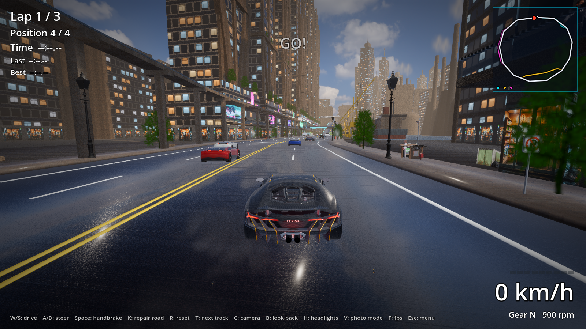

#### Circuit 4: Sector-9 Autobahn A-95
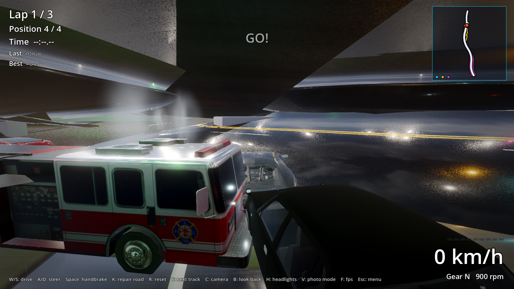

---

## 3. Automated Test Suite Results

| Test Script | Status | Verification Summary |
|:---|:---:|:---|
| [`dev_tools/verify_road_repair.gd`](file:///Users/j/Documents/Ridgeline Rally/dev_tools/verify_road_repair.gd) | **PASSED 100%** | Verified Area3D triggers, 0.60x friction slip reduction, async repair coroutine, particle lifecycle, and 1.00x grip restoration. |
| [`dev_tools/verify_tracks.gd`](file:///Users/j/Documents/Ridgeline Rally/dev_tools/verify_tracks.gd) | **PASSED 100%** | All 5 circuits loaded, tested across physics ticks with valid curves, bounding boxes, and AI competitors. |
